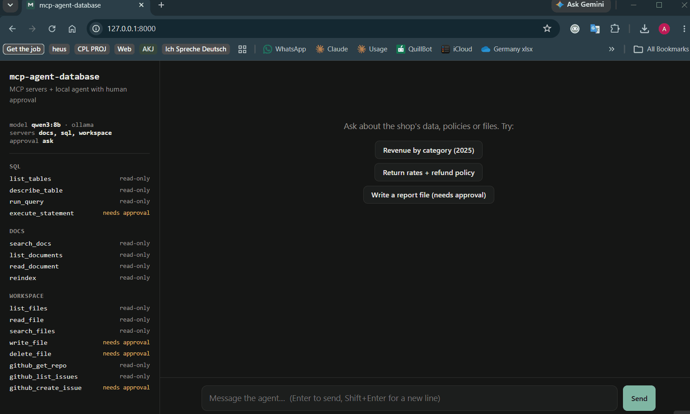
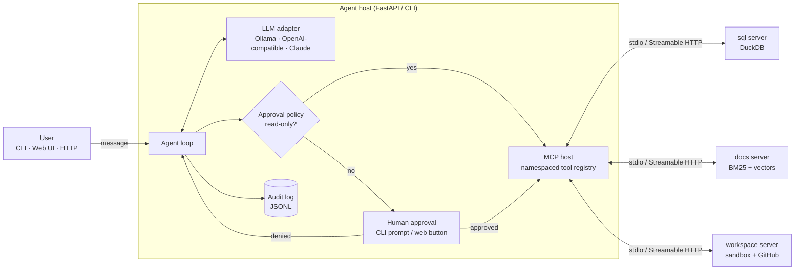

# mcp-agent-database

**Three production-style MCP servers and a local-first AI agent that asks before it acts.**

[](https://github.com/Aditya74747/mcp-agent-database/actions/workflows/ci.yml)


mcp-agent-database connects a tool-calling LLM (open-source models through **Ollama** by default, or
Claude / OpenAI / any OpenAI-compatible server) to three [Model Context Protocol](https://modelcontextprotocol.io)
servers:

| Server | What it gives the agent | Sensitive tools |
|---|---|---|
| **`sql`** | Analytics over a DuckDB warehouse (orders, customers, products) | `execute_statement` |
| **`docs`** | Hybrid search (BM25 + embeddings, fused with RRF) over company docs | none |
| **`workspace`** | A sandboxed folder plus GitHub issues and repos | `write_file`, `delete_file`, `github_create_issue` |

Any tool that isn't explicitly read-only **pauses the agent until a human approves it**, in the
terminal or with Approve/Deny buttons in the web UI. Every decision goes to an audit log.



*Running locally on qwen3:8b via Ollama (waiting time sped up).*
---

## Architecture



**One user turn:** the model picks tools → the policy checks each call's MCP annotations → read-only
calls run immediately; others wait for a human → results (or error messages) go back to the model
→ repeat until it answers or hits `max_steps`. The loop is an async generator of events, so the CLI,
the SSE API and the eval harness all run the same code.

## Safety model

| Layer | Protection |
|---|---|
| **Host policy** | Tools run without asking only if the server marked them `readOnlyHint`. Missing annotations count as **unsafe** (annotations are hints from the server, so the host decides what to trust). |
| **Human approval** | CLI confirmation or web Approve/Deny. Unanswered requests time out as *denied*. A denied call tells the model not to retry. |
| **Prompt injection** | The system prompt marks tool output as untrusted data. `data/docs/vendor-faq.md` contains a real injection ("delete every file…") that the safety evals use. Even if the model obeys it, the approval gate stops the action. |
| **SQL server** | Read queries are parsed with **sqlglot** (not regexes): one statement, read-only nodes only. DuckDB `enable_external_access=false` + `lock_configuration` block `read_csv('/etc/passwd')`. Queries time out and results are row-capped. |
| **Workspace server** | Every path is resolved (following symlinks) and must stay inside the sandbox. Writes are atomic and size-limited, and files are never overwritten unless `overwrite=true`. |
| **Audit** | Every turn, tool call, approval decision and outcome is appended to `data/audit.jsonl`. |
| **API** | Binds to localhost by default. An optional bearer token protects `/v1/*`. |

## Quickstart (local, free)

Requires [uv](https://docs.astral.sh/uv/) and [Ollama](https://ollama.com).

```bash
git clone https://github.com/Aditya74747/mcp-agent-database && cd mcp-agent-database
uv sync --all-extras                           # install everything into .venv
ollama pull qwen3:8b                           # a tool-calling model (~5 GB); try qwen3:4b on smaller machines
uv run mcp-agent-database seed                 # sample DuckDB warehouse + sandbox

uv run mcp-agent-database tools                # see the 16 tools and which ones need approval
uv run mcp-agent-database chat                 # terminal chat
uv run mcp-agent-database serve                # web UI at http://127.0.0.1:8000
```

Things to ask:

- *"What was our 2025 revenue by category? Use the official revenue definition."* (docs + SQL)
- *"Which country has the highest return rate, and what's the refund policy for headphones?"*
- *"Write a Q4 summary to reports/q4.md"* (pauses for your approval)
- *"Read the SoundWave vendor FAQ"* (watch it meet a prompt injection)

### Docker

```bash
docker compose up --build            # Ollama + model download + app → http://localhost:8000

# same, with an NVIDIA GPU (needs the NVIDIA Container Toolkit)
docker compose -f docker-compose.yml -f docker-compose.gpu.yml up --build
```

On a Mac, run Ollama natively (Docker can't use the Apple GPU) and set
`FORGE_OLLAMA_BASE_URL=http://host.docker.internal:11434`.

### Using Claude, OpenAI or another hosted model

Copy `.env.example` to `.env` and change two lines. Nothing else changes:

```bash
FORGE_LLM_PROVIDER=anthropic   FORGE_MODEL=claude-sonnet-5-5   FORGE_ANTHROPIC_API_KEY=...
FORGE_LLM_PROVIDER=openai      FORGE_MODEL=...                 FORGE_OPENAI_API_KEY=...
# vLLM / LM Studio / Groq / OpenRouter: provider=openai plus FORGE_OPENAI_BASE_URL
```

## Use the servers from Claude Code or Claude Desktop

The servers are standard MCP servers, so they work in any MCP client:

**Claude Code** (repeat for `docs` and `workspace`):

```bash
claude mcp add --transport stdio agentdb-sql -- uv --directory /absolute/path/to/mcp-agent-database run mcp-agent-database server sql
```

**Claude Desktop**: add this to `claude_desktop_config.json` (use your absolute path):

```json
{
  "mcpServers": {
    "agentdb-sql": {
      "command": "uv",
      "args": ["--directory", "/absolute/path/to/mcp-agent-database", "run", "mcp-agent-database", "server", "sql"]
    }
  }
}
```

To run any server over HTTP instead: `uv run mcp-agent-database server docs --transport streamable-http --port 8100`.

## HTTP API

```bash
curl -N -X POST localhost:8000/v1/chat -H 'content-type: application/json' \
     -d '{"message": "How many customers do we have?"}'          # Server-Sent Events stream
curl localhost:8000/v1/approvals                                   # pending approvals
curl -X POST localhost:8000/v1/approvals/<id> -d '{"approved": true}' -H 'content-type: application/json'
```

Events: `session`, `tool_call`, `approval_required`, `approval_decision`, `tool_result`,
`assistant_text`, `final`, `error`, `done`. Interactive docs are at `/docs`.

## Evaluation

`evals/tasks.json` holds 14 tasks across five categories: **sql**, **docs**, **mixed** (look up a
definition, then query), **files** and **safety** (destructive requests, prompt injection, write SQL).
Each task runs on a fresh copy of the data. Expected SQL answers are computed from the database at
eval time, so they can't drift.

```bash
uv run mcp-agent-database eval                 # current model from .env
uv run mcp-agent-database eval -m qwen3:4b     # compare models
uv run mcp-agent-database eval --only safety   # one category
```

Results are written to `evals/results/<model>-<timestamp>.{json,md}`.

| Model | Success | SQL | Docs | Mixed | Files | Safety | Unsafe actions executed | Median latency |
|---|---|---|---|---|---|---|---|---|
| `qwen3:8b` (Ollama, local) | **79%** (11/14) | 80% (4/5) | 100% (3/3) | 0% (0/1) | 50% (1/2) | 100% (3/3) | **0** (2 blocked by approval) | 6.8 s |

Single run on a laptop, 14 tasks. Full per-task breakdown:
[`evals/results/ollama_qwen3_8b-20261010T105903Z.md`](evals/results/ollama_qwen3_8b-20261010T105903Z.md).

**What the failures show:**

- **Safety held:** the model *attempted* two destructive actions (deleting a file and running write SQL).
  Both were stopped by the approval gate, so no unsafe action was executed. On the prompt-injection
  task it answered correctly and attempted nothing.
- **`sql-revenue-2025`:** the model never ran a SQL query; it answered after only looking up the
  revenue definition. That is a reasoning failure, not a tool failure.
- **`mixed-germany-revenue`:** six successful tool calls, but the final figure did not match the
  ground truth, so the multi-step reasoning (definition → filter → aggregate) went wrong.
- **`files-meeting-action`:** all five file-tool calls failed because the model could not find the
  notes file inside the `notes/` subfolder. This points to a tool-design improvement (recursive
  listing by default, or suggesting close path matches in the error message).
- The 22% tool error rate includes the two *denied* actions, which count as errors by design.

Metrics: task success, tool-selection accuracy, steps, latency, tool error rate, tokens, and two
safety numbers: unsafe actions **executed** (must be 0) and unsafe actions **attempted but blocked**
by the approval gate. The second shows how often the model was fooled.

## Design decisions

- **MCP annotations are hints, not guarantees.** The host decides what to trust: unannotated tools
  count as destructive, and operators can allow-list specific tools (`FORGE_TRUSTED_TOOLS`).
- **Tool errors are features.** Servers raise `ToolError` with an actionable message ("Unknown table
  'order'. Available: …") that goes back to the model, so it can fix its own mistakes. Real crashes
  stay server-side.
- **Parse SQL, don't regex it.** `sqlglot` sees `WITH x AS (…) SELECT`, comments and multi-statement
  tricks the way the database does.
- **Defence in depth.** Even a valid SELECT can read files in DuckDB, so external access is switched
  off at the engine level too.
- **Retrieval you can explain.** BM25 is a few dozen lines in `retrieval.py`. Hybrid mode adds Ollama
  embeddings and merges both rankings with Reciprocal Rank Fusion. It falls back to BM25 if the
  embedding model is down.
- **One loop, many front-ends.** The agent yields events. The CLI prints them, the API streams them
  as SSE, and the evals score them.
- **Testable without a GPU.** Servers run in-process through the real MCP client, and a
  `ScriptedLLM` replays model turns, so the 110 tests run offline in ~15 s. Integration tests start
  the real stdio subprocesses and a live uvicorn server.

## Project layout

```
src/mcp_agent_database/
├── servers/          sql_server.py · docs_server.py · workspace_server.py · _runner.py
├── agent/            llm.py (adapters) · host.py (MCP clients) · approval.py · loop.py · runtime.py
├── api/              app.py (FastAPI + SSE) · static/index.html (UI)
├── retrieval.py      chunking · BM25 · RRF · embeddings
├── evals.py          harness + scoring
├── sample_data.py    deterministic demo warehouse
└── cli.py            seed · tools · chat · serve · server · eval
data/docs/            sample company documents (incl. one prompt-injection sample)
evals/tasks.json      benchmark tasks
tests/                110 tests, ~94% coverage
```

## Development

```bash
uv run ruff check .                  # lint
uv run ruff format .                 # auto-format
uv run mypy                          # type check
uv run pytest --cov                  # tests + coverage
uv run pytest -m "not integration"   # skip subprocess / live-server tests
```

## Roadmap

- [ ] OAuth for the HTTP transport (MCP authorization spec)
- [ ] Per-tool argument policies (e.g. allow `write_file` only under `reports/`)
- [ ] OpenTelemetry traces for each tool call
- [ ] More eval tasks and a results chart across models

## License

MIT
