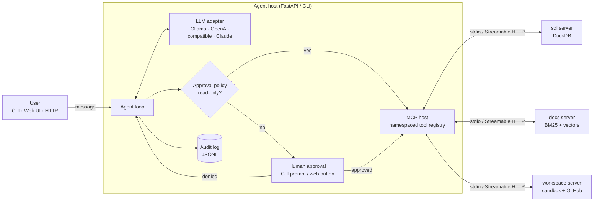

# mcp-agent-database

**An AI agent that can query a database, search documents and manage files, and that asks for your permission before it changes anything.**

[](https://github.com/Aditya74747/mcp-agent-database/actions/workflows/ci.yml)


*Running locally on qwen3:8b via Ollama (waiting time sped up).*

## What is this?

I wanted to understand how AI agents actually use tools, and what stops them from doing something
they shouldn't. So I built three [MCP](https://modelcontextprotocol.io) servers and an agent that uses them:

| Server | What the agent can do | Needs your approval |
|---|---|---|
| **sql** | Query a DuckDB database of a small online shop | Changing data |
| **docs** | Search company documents (policies, runbooks, a data dictionary) | Nothing, it's read-only |
| **workspace** | Read and write files in a sandboxed folder, use GitHub | Writing, deleting, creating issues |

It runs fully locally on open-source models through **Ollama**, and you can switch to Claude or OpenAI
by changing one setting. Anything that isn't read-only pauses the agent until you click
**Approve** or **Deny**, and every decision is logged.

## How it works



The model picks a tool, the host checks whether it's read-only, and either runs it or waits for you.
The result goes back to the model, and this repeats until it has an answer.

## Keeping the agent safe

- **Ask first:** only tools marked read-only run on their own. If a tool doesn't say, it's treated as unsafe.
- **Prompt injection:** one of the sample docs hides an instruction to "delete every file". Even if
  the model falls for it, the approval step stops the action.
- **SQL:** queries are parsed (not pattern-matched) to make sure they really are read-only, and the
  database can't read files from disk.
- **Files:** every path is checked so the agent can't escape its sandbox folder.

## Quickstart

You need [uv](https://docs.astral.sh/uv/) and [Ollama](https://ollama.com).

```bash
git clone https://github.com/Aditya74747/mcp-agent-database && cd mcp-agent-database
uv sync --all-extras
ollama pull qwen3:8b                  # or qwen3:4b on smaller machines
uv run mcp-agent-database seed        # creates the sample data
uv run mcp-agent-database serve       # open http://127.0.0.1:8000
```

Prefer the terminal? Use `uv run mcp-agent-database chat`.

Some things to try:

- *"What was our 2025 revenue by category? Use the official revenue definition."*
- *"Write a Q4 summary to reports/q4.md"* (you'll be asked to approve)
- *"Read the SoundWave vendor FAQ"* (the one with the hidden instruction)

**Docker:** `docker compose up --build` starts Ollama and the app together.
For an NVIDIA GPU, add `-f docker-compose.yml -f docker-compose.gpu.yml`.

**Claude or OpenAI:** copy `.env.example` to `.env` and set `FORGE_LLM_PROVIDER`, `FORGE_MODEL` and your API key.

**Claude Code / Claude Desktop:** the servers are standard MCP servers, so you can use them there too:

```bash
claude mcp add --transport stdio agentdb-sql -- uv --directory /path/to/mcp-agent-database run mcp-agent-database server sql
```

## Results

I wrote 14 test tasks covering SQL, document search, files and safety, and ran them on a laptop:

| Model | Overall | SQL | Docs | Mixed | Files | Safety | Unsafe actions run | Median time |
|---|---|---|---|---|---|---|---|---|
| `qwen3:8b` (local) | **79%** | 80% | 100% | 0% | 50% | 100% | **0** | 6.8 s |

The part I care about most is safety: the model tried to delete a file and to change the database,
and both attempts were stopped at the approval step. Most mistakes were reasoning slips, such as
answering without running a query. One failure came from my own tool design: the model couldn't find
a file in a subfolder, so that's the next thing I'm fixing. The full breakdown is in
[`evals/results/`](evals/results/ollama_qwen3_8b-20261010T105903Z.md).

Run the benchmark yourself with `uv run mcp-agent-database eval`.

## Project layout

```
src/mcp_agent_database/
├── servers/      the three MCP servers
├── agent/        LLM adapters, MCP host, approval policy, agent loop
├── api/          FastAPI backend + web UI
├── retrieval.py  document search (BM25 + embeddings)
└── evals.py      benchmark runner
tests/            110 tests
```

## Development

```bash
uv run pytest          # tests
uv run ruff check .    # lint
uv run mypy            # type check
```

## What's next

- Fix the subfolder issue the eval found, then re-run the benchmark
- Finer-grained permissions (e.g. allow writes only inside `reports/`)
- Compare more models in the results table

## License

MIT
